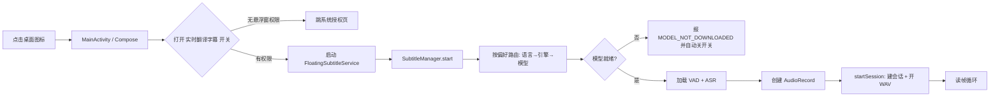

# 运行逻辑与参数（Runtime Pipeline）

面向维护者：一条音频从麦克风进入到变成复习卡片的完整链路、每一层的关键参数，以及**想改参数该去哪个文件改哪一行**。
需求层面的描述见 [REQUIREMENTS.md](REQUIREMENTS.md)；记录功能的存储细节见 [RECORDS.md](RECORDS.md)。

---

## 1. 分层与依赖

```
UI (Compose)             MainActivity / ui/* / FloatingSubtitleService
        │ 开关、设置、渲染
编排 (ViewModel)          SubtitleManager（唯一“大脑”，约 2600 行）
        │ PCM 帧 / 文本 / 译文
引擎层 (engine)           SileroVad / SherpaOnnxAsr / VoskAsr / MlKit / Cloud / LLM
        │ 结果
领域层 (domain)           路由表、SM-2、模型目录、仓库接口（纯 Kotlin，无 Android 依赖）
        │
数据层 (data)             Room(eye.db) + DataStore + records/ 文件
```

依赖方向：`app → engine → domain`、`app → data → domain`。仓库接口声明在 `domain`、实现在 `data`，Hilt 在 `app/di/AppModule.kt` 装配。

### 关键文件

| 位置 | 职责 |
| --- | --- |
| `app/.../viewmodel/SubtitleManager.kt` | 采集循环、VAD 决策、ASR 喂音、切行、翻译调度、记录挂点 |
| `app/.../FloatingSubtitleService.kt` | 悬浮窗（WindowManager 原生 View）、前台通知 |
| `app/.../ui/records/` | 记录本四页、点词弹层、TTS、按句回放、复习提醒 |
| `engine/.../vad/SileroVadEngine.kt` | Silero VAD 封装 |
| `engine/.../asr/SherpaOnnxAsrEngine.kt`、`VoskAsrEngine.kt` | 两套流式识别 |
| `engine/.../translation/` | ML Kit / 云（5 家）/ LLM 三条翻译链路 |
| `domain/.../model/AsrRouting.kt` | 语言→引擎→模型路由（单一事实源） |
| `domain/.../model/SherpaOnnxModel.kt` | 模型清单（文件名、体积、下载地址） |
| `domain/.../model/ReviewScheduler.kt` | SM-2 复习排程 |
| `data/.../repository/TranscriptRepositoryImpl.kt` | 会话/句子/语音落盘、JSON 快照、删除 |

---

## 2. 启动链路



- `SubtitleManager` 是 Hilt `@Singleton`，Activity 与 Service 共享；UI 只是 `subtitleState: StateFlow<SubtitleState>` 的观察者，退后台/切 App 不影响字幕。
- 关闭开关 = `stopAudioProcessing()` → 释放 `AudioRecord` → `finishSession()` → Service 停前台、撤浮窗。
- `MainActivity` 支持 `EXTRA_OPEN_RECORDS`（复习通知直达记录本）。

---

## 3. 音频采集

| 项 | 值 | 常量 |
| --- | --- | --- |
| 采样率 | 16000 Hz | `SAMPLE_RATE` |
| 位深 / 声道 | PCM 16bit / 单声道 | `ENCODING_PCM_16BIT` / `CHANNEL_IN_MONO` |
| 帧长 | 480 样本 = 30 ms | `FRAME_SIZE` / `FRAME_MS` |
| 缓冲 | `max(minBufferSize, FRAME_SIZE*4)` | — |

- 麦克风：`MediaRecorder.AudioSource.VOICE_RECOGNITION`（系统 AGC/AEC/NS）。
- 应用内声音：Android 10+ `AudioPlaybackCaptureConfiguration` + `MediaProjection`，每次开启需重新授权录屏。
- 视频输入模式（语音输入）不建会话、不写盘。

---

## 4. VAD（Silero）

模型 `assets/silero_vad.onnx`，**643 KB 随包内置**，首次启动拷到 `files/models/vad/`，`Vad` 实例懒加载。

| 参数 | 值 |
| --- | --- |
| SAMPLE_RATE | 16000 |
| WINDOW_SIZE | 512（≈32 ms） |
| THRESHOLD | 0.5 |
| MIN_SILENCE_DURATION | 0.25 s |
| MIN_SPEECH_DURATION | 0.25 s |
| MAX_SPEECH_DURATION | 5.0 s |
| numThreads / provider | 1 / cpu |

上层防抖（单位 30 ms 帧）：

| 常量 | 帧 | 时间 | 作用 |
| --- | --- | --- | --- |
| `VAD_PREROLL_FRAMES` | 34 | ≈1.02 s | 检测到语音时回填之前 1 秒，避免吞句首 |
| `VAD_SPEECH_DEBOUNCE_FRAMES` | 5 | ≈160 ms | 连续 5 帧才算“开始说话” |
| `VAD_SOFT_SILENCE_FRAMES` | 15 | 480 ms | 软静音，让 Vosk 侧收口 |
| `VAD_SILENT_DEBOUNCE_FRAMES` | 28 | ≈896 ms | 认定句末，提交字幕 |
| `VAD_STOP_ASR_FRAMES` | 60 | ≈2 s | 长静音暂停送音，省 CPU |

要点：**VAD 不切句**。切句由 ASR endpoint 与标点决定；VAD 只决定“送不送音”和 UI 的说话/静音指示。VAD 初始化失败会退化成“始终有语音”，保证 ASR 不哑火。

---

## 5. ASR：语言 → 引擎 → 模型

路由表在 `AsrRouting`，优先级：zh/en → X-ASR；bn → BN；Nemotron 26 语 → Nemotron；其余 → Vosk。**zh/en 永不回退 Nemotron**。

| 模型 | 语言 | 结构 / 类型 | 体积 | 来源 |
| --- | --- | --- | --- | --- |
| X-ASR zh-en 960ms int8 | zh / en（中英混说） | Zipformer2 transducer，`modelType=zipformer2` | ≈161 MB（encoder 155.3 MB + decoder 11.3 MB + joiner 2.6 MB + tokens 57 KB） | ModelScope CDN |
| Nemotron 3.5 0.6B 320ms int8 | 26 语（不含 zh/en/bn） | FastConformer-Hybrid RNNT，`modelType` 留空自动探测 | ≈685 MB（encoder 657.6 / decoder 15.0 / joiner 9.5 / tokens 131 KB） | HuggingFace |
| BN Vosk 2026-02-09 | bn | zipformer2，tar.bz2 解压 | 87,289,525 B ≈83 MB | GitHub Release |
| Vosk 小包（38~100 MB/语言） | 兜底语种 | Kaldi 流式 | 每语言单独 | alphacep |

识别器参数（`SherpaOnnxAsrEngine`）：

| 参数 | 值 |
| --- | --- |
| numThreads | 2 |
| provider | cpu |
| decodingMethod | greedy_search |
| enableEndpoint | true |
| rule1 | 静音 1.2 s 切句（长停顿） |
| rule2 | 停顿 0.6 s 切句（连读主力） |
| rule3 | 20 s 强制切（兜底） |
| sampleRate | 16000 |
| Nemotron 语种 | `stream.setOption("language", xx)`，不支持则告警不阻断 |

---

## 6. 文本整理与切行

`emitRow()` 前依次处理：

1. **标点切句**：`SENTENCE_END_MARKS = 。．.！!？?…`，缩写白名单（`U.S.`、`Mr.` 等）不切。
2. **长度兜底**：`MAX_ROW_CHARS_EN=90`、`MAX_ROW_CHARS_ZH=30`，超限在最近逗号/空格处切。
3. **去重**：归一化（只留字母数字 + 小写），长度 ≥ `MIN_DUP_CHECK_CHARS=6` 才参与包含判断；记忆窗口 `RECENT_ROWS_MEMORY=8`。
4. **半句补全**：引擎把半句补成整句时，用新句替换旧半句，不产生两行。
5. **锚点重定位**：上一行末尾 4/3/2/1 个词依次当锚点，重算“已收口位置”。
6. **收口**：写内存历史（保留 `MAX_HISTORY_LINES=10`）→ `addLine(text, currentAudioPositionMs())` → `translate(text)` → 清草稿缓冲。

增量预览（PARTIAL 行）：`PARTIAL_TRANSLATE_STEP_ZH=5` / `PARTIAL_TRANSLATE_STEP_EN=20` 字符触发一次轻量翻译，只更新最后一条 PARTIAL，不写记录。

---

## 7. 翻译三链路

默认 `translation_engine=LOCAL`，语言对默认 `en → zh`。

### LOCAL — ML Kit
- `TranslatorOptions` 按语言对建实例，LRU 最多 3 个；
- `downloadModelIfNeeded(DownloadConditions.Builder().build())` 首次下 30~100 MB/语言对；
- 依赖 GMS + 可访问 Google，国产机常直接失败；
- 支持 41 种语言，完全离线。

### CLOUD — 云翻译
- 五家实现：Baidu / Google Cloud / Azure / DeepL / Papago，默认 `PAPAGO`；
- API key AES 加密存 DataStore（`*_enc`）；
- 不支持的语言对抛 `UnsupportedOperationException`，上层静默跳过。

### AI — LLM 流式
- Provider 默认 `OPEN_AI`，可切 Claude 或自定义 OpenAI 兼容端点（`llmUrl` / `llmModel`）；
- 一次调用完成“润色 + 翻译”，system prompt 注入**上一句原文+译文**作为术语参考（只留 1 句，`lastLinePair`）；
- temperature：对话接口 0.7，兼容端点 0.3；
- 超时与容错：
  - 首 token `STREAM_FIRST_TOKEN_TIMEOUT_MS=15 s`（只约束开始）；
  - UI 节流 `STREAM_UI_MIN_INTERVAL_MS=100 ms`；
  - 读超时 30 s（OkHttp）；
  - 首 token 已到但流中断 → 采用已输出部分并提示“可能不完整”；零输出 → 保留原文，不写历史。

### 调度
- `TRANSLATE_DEBOUNCE_MS=200 ms`；
- 每次 `translate()` 递增 `translationVersion`，旧结果结构性丢弃但**不 cancel**，连读多句并发、按原文定位回写；
- 仅 `engine==AI && 文本长度>=MIN_POLISH_LENGTH(5)` 走润色链路。

---

## 8. 悬浮字幕渲染

| 项 | 值 |
| --- | --- |
| 窗口类型 | Android 8+ `TYPE_APPLICATION_OVERLAY`；更早 `TYPE_PHONE` |
| Flags | `NOT_FOCUSABLE｜NOT_TOUCH_MODAL｜WATCH_OUTSIDE_TOUCH｜LAYOUT_IN_SCREEN` |
| 位置基准 | `Gravity.TOP｜START`，坐标与宽高持久化（`overlay_x/y/width/height`） |
| 显示模式 | `BILINGUAL`（默认）/ 仅原文 / 仅译文 |
| 字号 / 透明度 / 主题色 | 默认 16sp / 1.0 / 索引 5 |
| 高度 | 随行数在 `minHeightPx~maxHeightPx` 自适应，多行先预展开再收缩 |

---

## 9. 记录归档

```
/sdcard/Android/data/io.github.ztfang.eye/files/records/
└── <yyyyMMdd-HHmmss>/
    ├── audio.wav     16k/16bit/mono，流式写，44 字节头占位后回填
    └── session.json  起止时间、语种、逐句 {startMs,endMs,source,translation}
```

四个挂点（`SubtitleManager`）：

1. 录音启动成功且非语音输入 → `startSession()`
2. 每读一帧 → `appendAudio(buffer, shortsRead)`
3. `emitRow` 后 → `addLine(text, currentAudioPositionMs())`
4. `appendTranslationResult` 后 → `updateLineTranslation(source, translated)`

一致性：所有 DB 写经同一 `Channel` 单消费者保序；`awaitQueue()` 在收尾前排空；停录后 **5 分钟内**晚到译文回填 `lastFinishedSessionId`，2 秒后重写 JSON。

数据库 `eye.db` v3：`tb_session` / `tb_line` / `tb_vocab`（旧 `tb_history` 保留）。

删除口径：

- 录音结束**不删** wav（约 1.9 MB/分钟）；
- 记录删除默认「只删语音」（`deleteAudioOnly`），文字保留；「删除整条记录」需二次确认；
- 复习页可一键清理全部语音（`deleteAllAudio`），文字不受影响。

---

## 10. 学习闭环

**点词**：`TextLayoutResult.getOffsetForPosition` 取字符偏移 → `extractWordAt()` 提整词（标点/缩写/连字符安全），纯函数有单测。

**词典**：`assets/dict/a.tsv…z.tsv`，4 万词 ≈2.47 MB，字段 `词 \t 音标 \t 释义`；按首字母分片懒加载，LRU 8 桶；词形还原 `ies/ves/es/s/ied/ed/ing/er/est/ly/'s` + 双写辅音；查不到提示“未收录”但仍可标难词。

**难词**：同词重复标记返回 -1；自动抓「该句 + 前两句 + 后两句」三块语境。

**SM-2 变体**（`ReviewScheduler`）：

| 参数 | 值 |
| --- | --- |
| 质量分 | 2 忘记 / 3 勉强 / 4 记得 / 5 秒懂 |
| ease | 初始 2.5，夹在 1.3~2.8，`EF' = EF + (0.1 - (5-q)*(0.08+(5-q)*0.02))` |
| 新词 | 10 分钟后到期 |
| 第 1 次答对 | 10 分钟 |
| 第 2 次答对 | 1 天 |
| 之后 | `上次间隔 × ease`，起步档 1/3/7/16/35 天，夹 1~365 天 |
| 答错 | 归零 → 10 分钟重来，`lapses+1`，`repetitions=0` |
| 秒懂 / 勉强 | ×1.2 / ×0.8 |
| 已掌握 | 连续 5 次答对且间隔 ≥60 天 |

**提醒**：`AlarmManager.setInexactRepeating(RTC_WAKEUP, 每天 20:30, 1 天)` → 通知点击带 `open_records`；开关默认 false。

**发音**：系统 TTS（优先 en-US/en-UK）；按句回放用 MediaPlayer 单例 + `seekTo(startMs)` + Handler 停在 `endMs`。

---

## 11. 参数速查

| 类别 | 参数 | 值 |
| --- | --- | --- |
| 音频 | 采样率 / 位深 / 声道 / 帧 | 16 kHz / 16 bit / mono / 480 样本（30 ms） |
| VAD | window / threshold / minSilence / minSpeech / maxSpeech | 512(32ms) / 0.5 / 0.25s / 0.25s / 5s |
| VAD 防抖 | 开始 / 软静音 / 提交 / 停送 | 5 / 15 / 28 / 60 帧 |
| ASR | 线程 / 解码 / endpoint | 2 / greedy / 1.2s + 0.6s + 20s |
| 切行 | EN / ZH 上限 | 90 / 30 字符 |
| 翻译 | 去抖 / 首 token / UI 节流 | 200 ms / 15 s / 100 ms |
| 复习 | 首见 / 1st / 2nd / ease | 10 min / 10 min / 1 天 / 1.3–2.8 |
| 提醒 | 时间 | 每天 20:30 |
| 语音占用 | 估算 | ≈1.9 MB/分钟 |

---

## 12. 改参数落点（最常用）

| 想改什么 | 去哪改 |
| --- | --- |
| 帧长、采样率、VAD 防抖、切行上限、翻译去抖 / 超时 / 节流 | `SubtitleManager` 的 `companion object` 常量区（约 2480–2600 行） |
| VAD 阈值、最短语音/静音、最长语音 | `SileroVadEngine.Companion` |
| 识别线程数、解码方式、endpoint 三条规则 | `SherpaOnnxAsrEngine`（`getEndpointConfig()` 在 `OnlineRecognizer.kt`） |
| 模型清单 / 体积 / 下载地址 | `SherpaOnnxModel.kt`（新增模型同时改 `AsrRouting`） |
| 语言→引擎路由 | `AsrRouting.kt` |
| 词典规模 | `tools/build_dict.py` + `assets/dict/*.tsv` |
| 复习间隔、ease 区间、掌握条件 | `ReviewScheduler.kt` |
| 提醒时间 | `ReviewReminder.DEFAULT_HOUR / DEFAULT_MINUTE` |
| 浮窗默认尺寸、显示模式、字号 | `SettingsDataStore` 的默认值 + `FloatingSubtitleService` |
| 记录目录、JSON 字段 | `TranscriptRepositoryImpl` |

---

## 13. 已知限制与坑

- **LOCAL 翻译依赖 GMS**：国产机基本必失败，建议云端/AI；App 会在启动时提示。
- **模型体积大**：中英 161 MB、多语种 685 MB、孟加拉 83 MB，均首次手动下载；未下载点开关会报 `MODEL_NOT_DOWNLOADED`。
- **只支持 ARM 真机**：`jniLibs` 仅 `arm64-v8a` / `armeabi-v7a`，x86 模拟器 NO_MATCHING_ABIS。
- **应用内声音**每次开启都要重新授权 `MediaProjection`（平台限制）。
- **MIUI/HyperOS adb 安装**：`INSTALL_FAILED_USER_RESTRICTED` 需开 USB 安装 / 走手机端点安装包，详见 [INSTALL_AND_USAGE](../INSTALL_AND_USAGE.md)。
